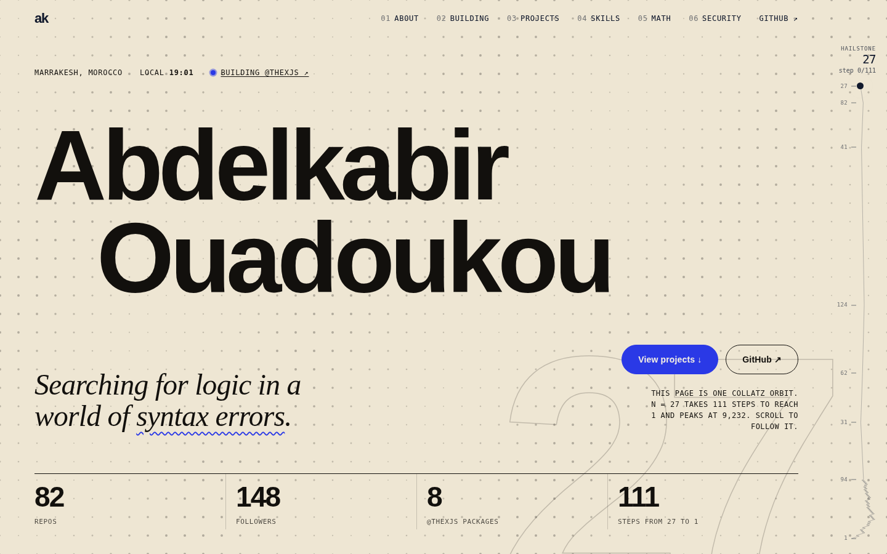

<div align="center">


# Abdelkabir Ouadoukou — *The Hailstone*

**My portfolio, and the whole page is one [Collatz](https://en.wikipedia.org/wiki/Collatz_conjecture) orbit.**<br />
Searching for logic in a world of syntax errors.

[**abdelkabir.me**](https://abdelkabir.me) · [GitHub](https://github.com/abdelkabirouadoukou) · [@thexjs](https://github.com/abdelkabirouadoukou/x)


</div>

<p align="center">
  
</p>

## The idea

Start at **n = 27**. If *n* is even, halve it; if odd, make it `3n + 1`. Repeat. It takes **111 steps** to fall to 1, and on the way it peaks at **9,232**. Nobody has proved that *every* number does this.

This site is that orbit. Each section is a step of it, and the spine on the right follows you down:

| section | n | step |
|---|---|---|
| start | 27 | `27` |
| about | 82 | `27 × 3 + 1` |
| building | 41 | `82 ÷ 2` |
| projects | 124 | `41 × 3 + 1` |
| skills | 62 | `124 ÷ 2` |
| math | 31 | `62 ÷ 2` |
| security | 94 | `31 × 3 + 1` |
| contact | 1 | …105 steps later |

## What's in it

- **Hailstone spine.** A live readout of the current *n*, with the orbit drawn as you scroll. It uses `mix-blend-mode: difference`, so it stays readable on every colour block.
- **@thexjs showcase.** A pinned horizontal rail of the eight packages of my own framework, which this site is built on.
- **Collatz lab.** Pick any start number and plot its orbit on a log scale.
- **Project index** with a generative canvas "specimen" per project on hover, instead of screenshots you'd have to host.
- **Motion that explains things.** Lenis smooth scroll, GSAP + ScrollTrigger reveals, a scroll-velocity marquee, magnetic buttons, a variable-font name that reacts to the pointer. All of it respects `prefers-reduced-motion`.
- **Contact** with a copy-to-clipboard button.
- **Real SEO.** Server-rendered title, Open Graph / Twitter cards, JSON-LD, canonical URL, generated `sitemap.xml` and `robots.txt`, `security.txt`. See [SEO](#seo--metadata).

## Stack

| | |
|---|---|
| Framework | [**@thexjs**](https://github.com/abdelkabirouadoukou/x), my own: Bun + React 19 SSR with islands |
| Motion | [Lenis](https://lenis.darkroom.engineering) + [GSAP](https://gsap.com) / ScrollTrigger |
| Styling | Plain CSS (`src/styles/globals.css`), compiled through Tailwind's CLI |
| Type | Bricolage Grotesque, Instrument Serif, Geist Mono |
| Hosting | Vercel (Build Output API v3 adapter) |

## Quick start

```bash
bun install
bun run dev                  # http://localhost:3000

bun run build && bun run start   # production build, served from .x/
```

| script | does |
|---|---|
| `bun run dev` | dev server with live reload |
| `bun run seo` | regenerates `sitemap.xml`, `robots.txt`, `security.txt` from `src/lib/site.ts` |
| `bun run build` | `seo` + production build |
| `bun run vercel-build` | `seo` + build with the Vercel adapter (what Vercel runs) |

## SEO & metadata

x ships a fixed `<title>x app</title>` and has no per-page head API, so without help, crawlers and link-preview bots (which don't run JavaScript) only ever see "x app". Instead:

- **`src/lib/site.ts`** is the single source of truth: name, title, description, canonical URL, email, links.
- **`src/pages/_middleware.ts`** rewrites the `<head>` of every HTML response on the server: real `<title>`, description, canonical, Open Graph, Twitter card, icons, manifest, and JSON-LD (`Person` + `WebSite`), built by `src/lib/head.ts`.
- **`scripts/seo.ts`** generates `public/sitemap.xml` (with the share image), `public/robots.txt` and `public/.well-known/security.txt` on every build. `lastmod` is the last git commit date, so it only moves when the site does.

**Changing the domain or the contact email?** Edit `url` / `email` in `src/lib/site.ts`, then `bun run seo`. Nothing else needs touching.

Check what a crawler sees:

```bash
curl -s localhost:3000 | sed -n '/<head>/,/<\/head>/p'
```

## Brand

| asset | where |
|---|---|
| Logo: geometric **a** + **k**; the k's ascender ends in the saffron ball, the *peak* of the hailstone | `design-system/abdelkabir/brand/logo.svg` |
| Favicon (SVG, `.ico`, 32px PNG), Apple touch icon, PWA icons | `public/` |
| Share image, 1200×630, the real n = 27 orbit plotted on it | `public/og.png` (source: `design-system/abdelkabir/brand/og.html`) |
| Colours, type, motion rules | `design-system/abdelkabir/MASTER.md` |

`og.png` is rendered from `og.html` at 1200×630 in any browser. The in-page nav logo is `src/components/Logo.tsx` (it uses `currentColor`).

## Structure

```
x.config.ts                      CSP (Google Fonts), port
scripts/seo.ts                   sitemap / robots / security.txt generator
design-system/abdelkabir/        MASTER.md + brand/ (logo.svg, favicon.svg, og.html)
docs/screenshot.png              README hero image
public/                          icons, og.png, manifest, generated sitemap/robots, styles.css
src/
  lib/site.ts                    site-wide metadata + contact (single source of truth)
  lib/head.ts                    <head> tags + JSON-LD builder
  lib/collatz.ts                 orbit maths, section ↔ step mapping
  pages/index.tsx                every section
  pages/_middleware.ts           injects the real <head> server-side
  pages/_404.tsx                 "this number never reaches 1"
  layouts/main.tsx               fonts + skip link
  styles/globals.css             all styling
  components/
    Choreo.tsx                   the one island that owns scroll: Lenis, GSAP, spine, cursor, reveals, clipboard
    HeroName.tsx                 variable-font proximity name (auto-fits)
    DotField.tsx                 pointer-reactive dot grid
    ProjectIndex.tsx             project list + generative hover previews
    CollatzLab.tsx               interactive orbit plotter
    Logo.tsx                     the ak mark
```

## Notes on building with x

- **Styles.** `x dev` / `x build` compile `src/styles/globals.css` into `public/styles.css` with Tailwind's CLI, and x only links `/styles.css` if the file exists. `tailwindcss` + `@tailwindcss/cli` are in `dependencies` for that reason, and `public/styles.css` is committed as a fallback. Edit `globals.css`, never the public copy.
- **Fonts.** x's default CSP blocks Google Fonts, so `x.config.ts` replaces it. Drop the `googleapis` / `gstatic` entries if you self-host the fonts.
- **One scroll owner.** Everything using GSAP / Lenis lives in the single `Choreo` island on purpose: separate islands are separate bundles, and two copies of GSAP would mean two ScrollTrigger registries that can't see each other.
- **No static mode.** Static output goes through `renderToStaticMarkup`, which strips the markers hydration relies on, so pages are server-rendered.
- **Client navigation.** In-page and external links carry `data-no-nav` so x's client router leaves them alone.
- **AI tooling.** `.mcp.json`, `.cursor/mcp.json`, `AGENTS.md` and `CLAUDE.md` come from the x scaffolder, so Claude Code / Cursor use `@thexjs/mcp` for grounded framework docs.

## License

[MIT](LICENSE) © Abdelkabir Ouadoukou
